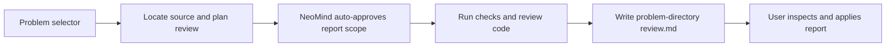

# LeetCode Review flow

Published flow ID: `leetcode-review` (display name: **LeetCode Review**).

## Input and output

Select the flow in NeoMind and enter one existing problem's title, slug, numeric
ID, or relative directory path as the task. For example:

```text
Review Add Two Integers in C.
```

For an unambiguous selector:

```text
Review c/big-o/2235_add-two-integers.
```

The deliverable is `review.md` inside that problem directory. A later review
refreshes that file. If multiple directories match (including C and C++ versions),
the flow stops and requests a more specific selector.

## Workflow



The plan and review steps are pinned to the `codex` runner, `openai` provider,
`gpt-6.1-terra` model and `high` reasoning (flow version 2).
Only one agent runs at a time. The active-time limit is 20 minutes.

NeoMind runs in an isolated Git worktree. Inspect the result and use **Apply to
checkout** to copy the report back into your working directory. The flow does
not commit changes.

If your latest solution is uncommitted, explicitly request that NeoMind include
the current uncommitted changes when starting the run. Otherwise the isolated
worktree may review an older committed solution. When starting through the MCP
tools, the caller must preview first and pass the returned dirty-import hash
only with the user's authorization. The report records the reviewed source
snapshot so you can tell which version was checked.

## Review contents

- Problem identification, constraints and their source, review date and source snapshot.
- Correctness findings with line references, a small-input trace or actual run,
  and counterexamples for demonstrated bugs.
- Pointer/buffer bounds and null terminators; ownership, allocation and freeing;
  signed/unsigned conversions, overflow and shift counts.
- Time and auxiliary-space analysis, including recursion stack, with evidence
  and explicit assumptions.
- Normal and ASan/UBSan test commands, exit codes, check counts and relevant output.
- Limitations, a qualified verdict and at most one next-step hint.

The report is written in English; the conversation summary is in Vietnamese,
following the repository rules. It does not contain a corrected implementation
or a full reference solution.

## Test interpretation and boundaries

The flow runs `tools/build_test.py` for the selected problem, normally and with
`--sanitize`. `TODO`, `NO TESTS`, unavailable compilers and unavailable sanitizer
support are reported as limitations, not successful verification. A TODO marker
may stop the repository harness from exercising otherwise present code; the
flow reports this without editing the solution.

Extra test harnesses may use temporary storage or ignored `build/` output and
must include the existing solution unchanged. The only report deliverable is
the selected problem's `review.md`. The flow must not modify solutions, tests,
notes, learning status or tooling, and never submits to LeetCode. Passing local
checks is not a claim of LeetCode acceptance.

Version 1 passed NeoMind flow validation and had no start blockers in preview.
This validates configuration; an end-to-end problem review has not yet been run.
